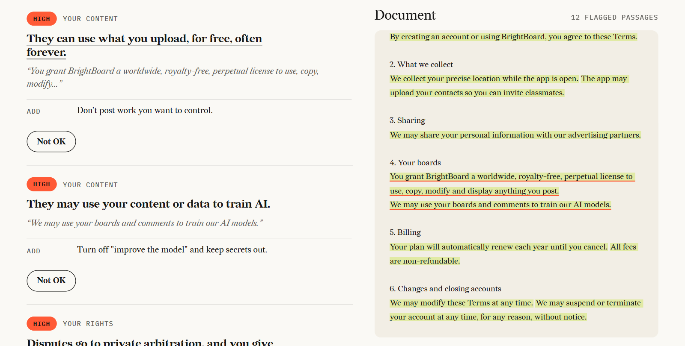

# Tickwise

Know what you are agreeing to before you tick.

Tickwise reviews a terms of service or privacy policy and explains, in plain English, the points to be aware of before accepting: the data collected, who it is shared with, the rights given up, the charges involved, and the choices available to opt out.

Each point quotes the exact sentence it is based on and includes one recommended safeguard. Each document receives a boundary score out of 100.

Tickwise does not provide legal advice.

## Web app

Use Tickwise in the browser at **https://niroxzv.github.io/TOS-checker/**.

Paste a document, open a file or load the sample, then select **Check**. All processing takes place in the browser; no text is uploaded.

## Browser extension

The extension reviews the page currently open, together with the Terms, Privacy and Cookie pages it links to. Download it from the [latest release](https://github.com/niroxzv/TOS-checker/releases/latest).

| Browser | File | Installation |
|---|---|---|
| Firefox | `tickwise.xpi` | Open the file in Firefox, or drag it onto a Firefox window, and select **Add**. The add-on is signed by Mozilla. |
| Edge or Chrome | `tickwise-extension.zip` | Unzip the file, open `edge://extensions` or `chrome://extensions`, enable **Developer mode**, select **Load unpacked** and choose the unzipped folder. |

The extension does not update automatically. To update, download and install the file from the newest release. Full instructions are in the [extension guide](docs/extension.md).

## How it works

Tickwise combines a set of hand-written rules with a small trained model that verifies their results. Both run locally on the device, without an AI service or a server, so results are immediate and documents remain private.

Points are grouped into six areas: data collected, data shared, your content, your rights, money, and your options. They are ordered by risk, and repeated occurrences of the same point are combined. A point marked **Not OK** becomes a dealbreaker: it is listed first, lowers the score and remains marked on every document reviewed afterwards.

## Accuracy

Tickwise has been evaluated on [UNFAIR-ToS](https://huggingface.co/datasets/coastalcph/lex_glue), a public dataset of terms of service sentences labelled by legal experts. On sentences excluded from training and tuning, it achieves a micro-F1 score of 95.2%. For comparison, a standard published baseline achieves 94.7%, and a large legal language model, too large to run in a browser extension, achieves 96.0%.

In practice, Tickwise incorrectly flags about 2 in 100 acceptable sentences and identifies about 3 in 4 unfair clauses. It is intended as a first review and does not replace reading the full terms.

## Privacy

- The web app and the extension run entirely in the browser. No data is sent to the developer or to any third party, and no account is required.
- The extension reads a page only when its icon is selected. Linked terms pages are retrieved without cookies, and permission is requested before any other website is contacted.
- Preferences are stored only in the browser.

## Limitations

- Tickwise analyses wording. Clauses phrased in unusual ways may be missed, and it cannot determine whether a term is enforceable in a given jurisdiction.
- A sentence that combines a denial and a permission (for example, "we do not sell X, but we sell Y") may be missed.
- Text copied from PDF files may be split into sentences incorrectly.
- The extension cannot read browser pages or add-on store pages, and does not read terms displayed inside frames.

A local AI mode that produces a plain-English summary is planned for a future release.

## Development

Information on the code structure, building, testing, adding rules and the full evaluation results is available in [docs/development.md](docs/development.md).

## Licence

Released under the MIT Licence and provided as is, without warranty. See [LICENSE](LICENSE). The bundled fonts are licensed under the SIL Open Font License.
