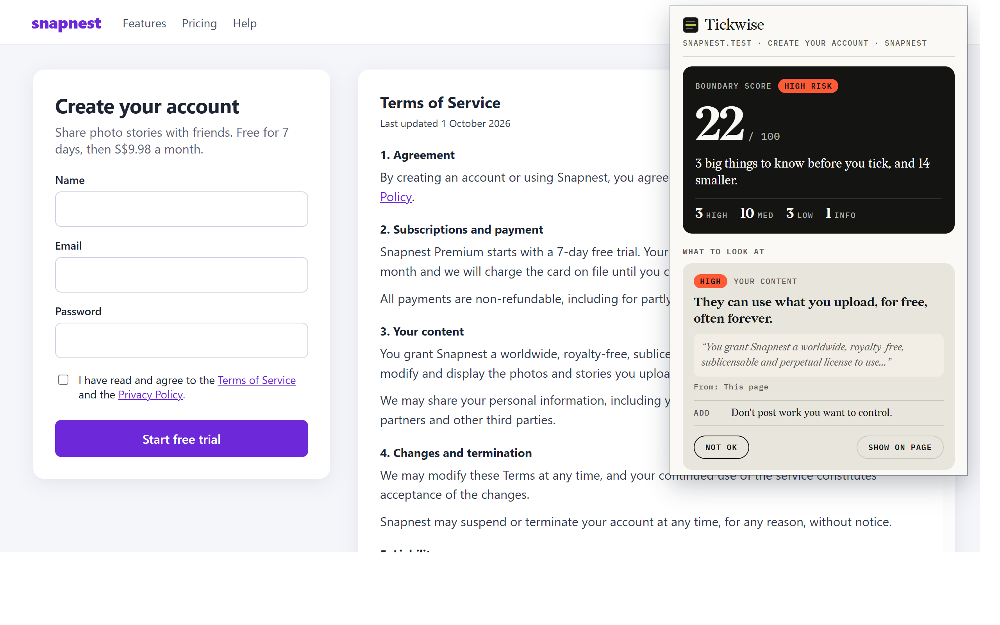

# Tickwise

Know what you're agreeing to before you tick. Tickwise reads a terms of service or privacy policy and tells you, in plain English, what you should know before clicking accept: what data they take, who they give it to, what rights you give up, what you pay, and what you can opt out of.

Every point quotes the exact sentence it came from, comes with one safeguard to **Add**, and the whole document gets a **boundary score** out of 100.

Not legal advice.

## Try it online

https://niroxzv.github.io/TOS-checker/

Paste some terms, open a file, or try the sample, then press **Check**. It all runs in your browser: nothing you paste is uploaded.

## Install the browser extension

The extension checks the page you're on, plus the Terms, Privacy and Cookie pages it links to. Download it from the [latest release](https://github.com/niroxzv/TOS-checker/releases/latest):

- **Firefox:** `tickwise.xpi`. Open it in Firefox (or drag it onto a Firefox window), then click **Add**. It's signed by Mozilla, so it stays installed.
- **Edge or Chrome:** `tickwise-extension.zip`. Unzip it, open `edge://extensions` or `chrome://extensions`, turn on **Developer mode**, click **Load unpacked** and choose the unzipped folder.

It doesn't update by itself: download the new file when there's a new release. How to use it: [the extension guide](docs/extension.md).

## How it works

Tickwise uses hand-written rules plus a small trained model that double-checks them. Both run on your device, with no AI and no server, so a check is instant and your documents stay with you.

It reads for points in six areas: data collected, data shared, your content, your rights, money, and what you can do about it. Points are sorted by risk, and repeats of the same point are folded together so you only read each one once. Mark a point **Not OK** to make it a dealbreaker: it moves to the top, lowers the score, and stays marked on every document you check.

## How accurate it is

Tickwise was measured on [UNFAIR-ToS](https://huggingface.co/datasets/coastalcph/lex_glue), a set of real terms of service sentences labelled by lawyers. On sentences it was never trained or tuned on, it scores 95.2% (micro-F1, the usual score for this dataset). A standard published approach scores 94.7%, and a large legal language model, far too big to run in a browser extension, scores 96.0%.

In plain terms: it wrongly flags about 2 in 100 harmless sentences, and on the unfair kinds of clause it finds about 3 in 4. So treat it as a quick first read, and read the full terms for anything that matters.

## Privacy

- The web app and the extension run entirely in your browser. Nothing is sent to the developer or anyone else, and there's no account.
- The extension only reads a page when you click its icon. It fetches linked terms pages without your cookies, and asks before it contacts another site.
- Your choices are kept in your browser only.

## Limits

- It reads what the words say, so it can miss points worded in unusual ways, and it can't tell you whether a term is legal where you live.
- A sentence that mixes a "we don't" with a "we do" can be missed.
- Text copied from a PDF can split sentences in odd places.
- The extension can't read browser pages or the add-on stores, and misses terms inside frames.

A local AI mode that writes a plain-English summary is planned for a future update.

## For developers

How it's built, how to run and test it, how to add a rule, and the full accuracy results: [docs/development.md](docs/development.md).

## Licence

MIT, provided as is with no warranty: see [LICENSE](LICENSE). The fonts are under the SIL Open Font License.
