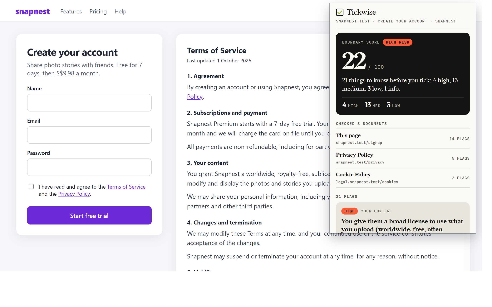
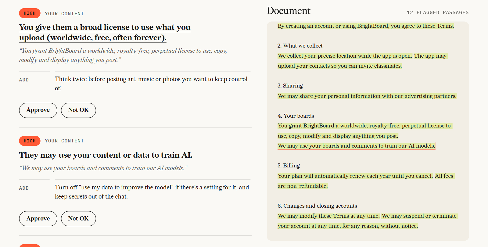

# Tickwise

Know what you're agreeing to before you tick. Tickwise reads a terms of service and flags what you should know before clicking accept: what data they take, who they give it to, what rights you give up, and what you can opt out of.

- **Rule mode** (always on): hand-written rules plus a small trained model that double-checks them. The checking runs on your device with no AI server, and it is instant. Every flag points at the exact sentence it came from. (The browser extension also downloads the terms pages a site links to, so it can check them too.)
- **AI mode** (optional): a small local model (tested: Qwen 3.5 4B/9B through Ollama; llama.cpp also works) reads only the clauses the rules pick out, writes a plain-English summary and catches what the rules missed. Every AI point must quote the text, and points whose quote isn't really in the document are thrown away.

Each kind of flag comes with one **Add**: a safeguard to put in place, shown once even if the same point comes up many times. The whole document gets a **boundary score** out of 100.

Not legal advice.





## Layout

| Folder | What it is |
|---|---|
| `src/` | Rule engine: clause splitter, rules, `analyze()` |
| `src/model.ts`, `src/model-weights.ts` | Small trained model (logistic regression) that confirms or adds the 8 benchmark clause types |
| `src/advice.ts`, `src/score.ts` | The safeguard to add for each rule, and the boundary score |
| `src/ai/` | AI mode: talks to a local `llama-server`, checks every quote |
| `app/` | Web app: paste or open a document (plain HTML/CSS/TS) |
| `extension/` | Browser extension (Firefox, Edge, Chrome) that checks the page you're on |
| `scripts/` | Zero-dependency build (strips types) and dev server |
| `test/`, `eval/` | Unit tests, and scoring against the UNFAIR-ToS dataset |
| `docs/` | Setup guides for AI mode and the extension |

## Run it

Needs Node 22.18 or newer. Node runs the `.ts` files directly, so there's nothing to install.

```bash
npm test
npm run analyze -- samples/sample-tos.txt
npm run dev
```

`npm run dev` builds the UI and serves it at http://127.0.0.1:5173. `npm run build` writes `dist/app/` (web app), `dist/extension/` (load it unpacked in Edge or Chrome) and `dist/firefox/` (load it in Firefox from about:debugging).

- AI mode (Ollama or llama-server): [docs/ai-mode.md](docs/ai-mode.md)
- Browser extension: [docs/extension.md](docs/extension.md)

## How the rule engine works

1. `src/split.ts` cuts the text into clauses (about one sentence each) and remembers where each one starts and ends.
2. `src/rules.ts` holds the rules. Each one has `match` patterns, optional `unless` patterns for negations ("we do **not** sell"), a severity and a plain-English line.
3. `src/engine.ts` runs every rule on every clause.
4. `src/model.ts` then scores each clause with a logistic regression over its words and word pairs plus which rules fired. It drops rule flags the model does not back up, and adds clause types the rules missed. A type that a rule explicitly ruled out with `unless` is never added back.
5. The result is the list of flags, most severe first.

To retrain the model (Python with scikit-learn, for developers only): `npm run train`. To score the rules without the model: `npm run eval:rules`.

### Add or fix a rule

1. Put a sentence it should catch in `hits` and one it shouldn't in `misses` in `test/fixtures.ts`.
2. Edit the rule in `src/rules.ts` until `npm test` passes.

Every rule must have at least one hit and one miss, or the tests fail.

## Measure it against real ToS (UNFAIR-ToS)

[UNFAIR-ToS](https://huggingface.co/datasets/coastalcph/lex_glue) is a set of real ToS sentences labelled by lawyers with 8 kinds of unfair clause. The rules that cover one of those kinds have an `unfairTos` field.

```bash
npm run eval:fetch
npm run eval
npm run eval -- test --misses
```

The first command downloads the dataset to `eval/data/`. The model is trained on train + validation, so only the **test** split is a fair score. With LexGLUE scoring, the held-out test split gives 95.2% micro-F1 and 77.9% macro-F1. The published TF-IDF + SVM baseline gets 94.7 / 75.0, and Legal-BERT 96.0 / 83.0. Over the 8 unfair types alone, micro-F1 is 74.9%. `--misses` prints sentences the rules missed, which is the quickest way to find the next rule to write.

The data rules (location, selling data, AI training and so on) aren't in UNFAIR-ToS. OPP-115, a set of privacy policies labelled by data practice, is the dataset to measure those against later.

## Known limits

- A negation anywhere in a clause cancels the whole rule for that clause ("we don't sell X, but we sell Y" is missed).
- Lines copied from a PDF that wrap mid-sentence before a capital letter get split in two.
- A clause that gives both sides the right to close an account is skipped by `unilateral_termination`.
