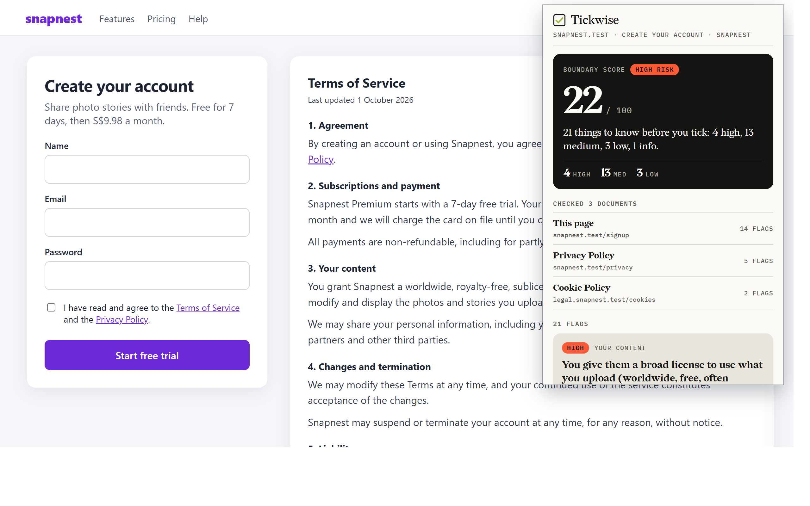

# Browser extension (Edge / Chrome)

The extension checks the terms of service on the page you're on, plus its linked Terms, Privacy and Cookie pages, using the same rule engine as the rest of the app (`src/engine.ts`). Not legal advice.



## Install it (about one minute)

You need the `dist/extension` folder. Either build it with `npm run build`, or unzip `tickwise-extension.zip`. Then:

1. Open **edge://extensions** in Edge, or **chrome://extensions** in Chrome.
2. Turn on **Developer mode**. In Edge it's in the left sidebar; in Chrome it's at the top right.
3. Click **Load unpacked** and choose the `dist/extension` folder (or the folder you unzipped). Pick the folder that has `manifest.json` directly inside it.
4. Click the puzzle-piece icon in the toolbar and pin **Tickwise**.
5. Open any sign-up page, terms of service or privacy policy, and click the **Tickwise** icon.

After changing the code, run `npm run build` again and click **Reload** on the extension's card.

To hand the extension to someone else, run `npm run pack:extension`. It builds and writes `tickwise-extension.zip` in the project root. They unzip it and follow the steps above.

## What it does

- **This page**: reads the visible text of the tab when you click the icon (`activeTab` + `scripting`; no background script).
- **Selected text**: if you selected more than 200 characters, that's checked as its own document and listed first.
- **Linked pages**: up to 8 links that look like Terms, Privacy, Cookie or legal pages are fetched from inside the page, so pages on the same site need no extra permission.
- **Other sites**: links on another origin can't be fetched from the page. They're listed under "Linked pages we couldn't read" with an **Allow reading N more pages** button, which asks for those origins (`optional_host_permissions`). Once you allow an origin, it's read straight away every time.
- **One report**: the boundary score band (its colour is the verdict), "Checked N documents" with a flag count for each, then one row per flag with severity, category, the plain-English point, the quote, **From: <document>**, **Add / Check / Tell**, and **OK / Not OK**.
- **Not OK** makes a rule a dealbreaker. It moves to the top, costs extra in the score, and is saved in `chrome.storage.local` (`tos-checker.prefs`, the same shape as the desktop app). Click it again to clear it.
- Browser pages (`edge://`, `chrome://`, the add-on stores) can't be read by any extension, so the popup says so.

The popup loads IBM Plex from Google Fonts, as the web app does. Offline, it falls back to the system font. No page text is sent with that request.

## Test it in a real browser

```bash
npm run build
npm run test:extension      # same as: node scripts/test-extension.ts
```

`scripts/test-extension.ts` uses no dependencies. It:

1. Serves a fictional sign-up page ("Snapnest") at `snapnest.test`, with its Privacy Policy on the same origin and its Cookie Policy on `legal.snapnest.test`. Both names point at 127.0.0.1 through `--host-resolver-rules`.
2. Starts headless Edge with a throwaway profile (deleted afterwards), and talks to it over `--remote-debugging-pipe` with `--enable-unsafe-extension-debugging`. It loads `dist/extension` with `Extensions.loadUnpacked`.
3. Clicks the toolbar button with `Extensions.triggerAction` (a real action click, so `activeTab` applies), attaches to the popup and checks the report. Then it clicks **Allow**, **Not OK**, selects text, and opens a browser page.
4. Saves the screenshots in `docs/screenshots/`.

Options: `BROWSER=<path to msedge.exe or chrome.exe>`, `PROFILE_DIR=<folder>`, `HEADED=1` to watch, `NO_SHOTS=1` to skip screenshots. It exits with code 1 if any check fails.

On Windows, run it from PowerShell or cmd. Edge launched from Git Bash exited straight away in our setup.

## Tested on

**Microsoft Edge 156.0.4314.58, Windows 11, headless, 6 November 2026: 33 of 33 checks pass.**

Verified in the real browser:
- The extension loads unpacked, and the toolbar click opens the popup with no console errors.
- It reads the current page and the same-origin Privacy Policy and Cookie Policy. It skips links that aren't legal pages (Help, Features).
- One merged report: the score band, "Checked N documents", and flags from every document, each with "From: <document>", Add / Check / Tell, and OK / Not OK.
- Cross-origin: the Cookie Policy on another origin is listed as unread with **Allow reading 1 more page**. Once the origin is granted, a real (trusted) click on Allow reads it, and the report goes to 3 documents. The next click on the icon reads it without asking.
- Selected text (410 characters) becomes the first document, and its flags say "From: Selected text".
- Not OK makes a dealbreaker, lowers the score (22 to 17), is saved to `chrome.storage.local`, and survives reopening. Clicking it again clears it.
- On `edge://version` the popup shows "Can't read this page."

Not verified, and why:
- **Answering the permission prompt.** Headless Edge can't show or click the browser's own prompt. The harness grants the origin the way Site access on edge://extensions does (`chrome.developerPrivate.addHostPermission`), then clicks Allow. On an origin that was never granted, the Allow click does open the prompt: Edge closes the popup as the prompt takes focus. So for a real user: click **Allow**, accept the prompt, then click the icon again, and the page is read straight away. That last step is verified.
- **The popup's own window size.** Headless Edge keeps the popup at the height of its first "Reading…" frame, where a real popup grows to fit, up to 600px. So the screenshots draw the popup's live DOM in `popup.html` opened as a tab (same CSS and fonts) at 380 × 600, or at full length for `extension-popup-full.png`.
- Chrome (none on the test PC), dark mode, very large pages, and terms inside iframes.

Screenshots: `extension-popup.png` (what you see on clicking), `extension-popup-full.png` (the whole report), `extension-popup-permission.png` (before Allow), `extension-popup-selection.png`, `extension-popup-dealbreaker.png`, and `extension-in-context.png` (popup over the page).

## Known gaps

- No icons yet, so the browser shows a default letter icon.
- It only reads the top frame, so terms inside an iframe are missed.
- One row per flag, so a rule that matches many sentences shows many rows.
- Linked pages that build their text with JavaScript come back mostly empty, because fetched HTML isn't run.
