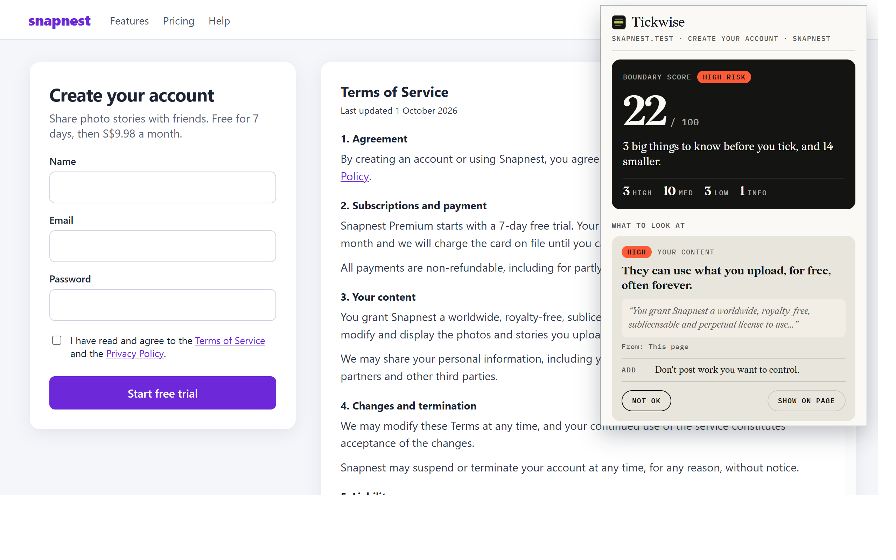

# Tickwise browser extension

The Tickwise extension reviews the terms of service on the page currently open, together with the Terms, Privacy and Cookie pages it links to, and explains in plain English what the user is agreeing to regarding their data, rights and money. Each point quotes the exact sentence it is based on. Tickwise does not provide legal advice.

## Installation

Download the files from the [latest release](https://github.com/niroxzv/TOS-checker/releases/latest).

### Firefox

1. Download `tickwise.xpi`.
2. Open the file in Firefox, or drag it onto a Firefox window, and select **Add**.
3. Firefox places new add-ons in the Extensions menu (the puzzle-piece icon). To show Tickwise in the toolbar, open that menu, select the gear icon next to **Tickwise** and choose **Pin to Toolbar**.

The add-on is signed by Mozilla and remains installed.

### Edge or Chrome

1. Download `tickwise-extension.zip` and unzip it.
2. Open **edge://extensions** in Edge, or **chrome://extensions** in Chrome.
3. Enable **Developer mode**. In Edge it is in the left sidebar; in Chrome it is at the top right.
4. Select **Load unpacked** and choose the unzipped folder (the folder that contains `manifest.json`).
5. Select the Extensions icon in the toolbar and pin **Tickwise**.

The browser loads the extension from the unzipped folder, so the folder should not be moved or deleted.

### Updating

The extension does not update automatically. When a new release is available, download the new file and install it in the same way. In Edge or Chrome, replace the contents of the folder and select **Reload** on the Tickwise card.

## Using Tickwise

Open a sign-up page, a terms of service or a privacy policy, and select the **Tickwise** icon.

- **Boundary score:** a score out of 100. A lower score indicates terms that ask more of the user.
- **What to look at:** one card for each type of point, highest risk first. Each card states the point, quotes the sentence it is based on, names the source document and recommends one safeguard under **Add**. Lower-risk points are grouped under **Show N smaller points**.
- **Show on page:** scrolls to the sentence on the current page and highlights it.
- **Open and show:** for a point found on a linked page, such as the Privacy Policy, opens that page at the sentence.
- **Not OK:** marks a point as a dealbreaker. It is listed first, lowers the score and remains marked on every website. Select it again to remove the mark.
- **Selected text:** selecting a passage of more than 200 characters before opening Tickwise reviews that passage as a separate document.
- **Badge:** the number on the toolbar icon is the number of high-risk points on the page.
- **Changes:** when the same page is reviewed again, Tickwise reports whether its terms have changed since the previous review and marks new points as **New**.

### Linked pages on other websites

Terms are often hosted on a different website, such as `legal.example.com`. Tickwise does not contact that website without permission. Such pages are listed under **Linked pages we couldn't read**, with an **Allow reading N more pages** button. Select the button and accept the browser's permission request. In Edge and Chrome the popup closes when the request appears; after accepting, select the Tickwise icon again. The browser remembers the permission for that website.

## Privacy

- Tickwise reads a page only when its icon is selected. Nothing runs in the background.
- No data is sent to the developer or to any third party. No account or server is involved.
- Linked terms pages are retrieved without cookies and without the address of the current page.
- **Not OK** choices, and a record of the points found on each page, are stored only in the browser. The record stores hashed values rather than page addresses; however, a person with access to the browser profile could still infer which common websites were reviewed. In private browsing windows, no record of reviewed websites is kept.

## Limitations

- Browser pages (`edge://`, `chrome://`, `about:`) and add-on store pages cannot be read by any extension.
- Terms displayed inside a frame on the page are not read.
- Linked pages that generate their text with JavaScript may return little or no text.
- Tickwise analyses wording. Clauses phrased in unusual ways may be missed, and it cannot determine whether a term is enforceable in a given jurisdiction.

Developer documentation: [building, testing and publishing the extension](extension-dev.md).
